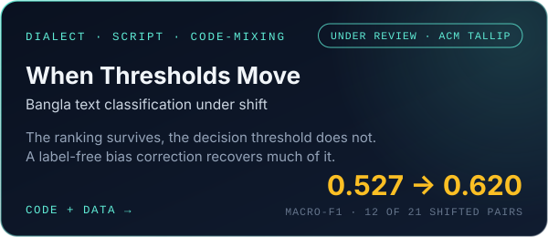
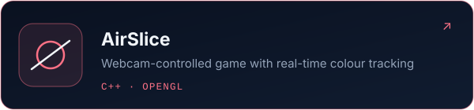
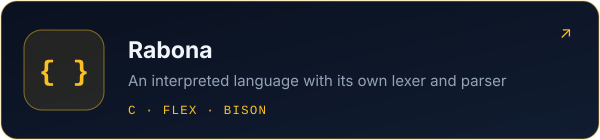

  

  &nbsp;
  &nbsp;
  

## About

A model can rank every example in the right order and still make the wrong call, because the line it uses to decide
has quietly moved. That gap is what I study. My work looks at Bangla text classifiers as they meet regional dialects,
Bangla typed in Latin letters, and text that mixes Bangla, English and Hindi, and asks which parts of their confidence
can still be trusted. I answer it with controlled experiments, released model outputs, and numbers that trace back to
code.

Outside research I build software end to end, from a language interpreter in C to web platforms in React and Next.js.

**Now**

- The Bangla threshold-shift study is under review at ACM TALLIP.
- Extending it into my undergraduate thesis.
- Final year of Computer Science and Engineering at Metropolitan University, Sylhet.

## Research

  
  

Model outputs for the threshold-shift study are archived on Zenodo: [doi:10.5281/zenodo.24057514](https://doi.org/10.5281/zenodo.24057514).

## Projects

  
  
  
  

## Toolkit

  <picture>
    <source media="(prefers-color-scheme: dark)" srcset="https://skillicons.dev/icons?i=py,pytorch,sklearn,c,cpp,java,js,react,nextjs,nodejs,express,mysql,tailwind,git,linux&theme=dark&perline=15">
    
  </picture>

Also Hugging Face Transformers for NLP, and 1,000+ competitive programming problems solved.

  

