

  

  
  
  
  

A model can rank every example in the right order and still make the wrong call, because the line it uses to decide
has quietly moved. That gap is what I study. My work looks at Bangla text classifiers as they meet regional dialects,
Bangla typed in Latin letters, and text that mixes Bangla, English and Hindi, and asks which parts of their confidence
can still be trusted. I answer it with controlled experiments, released model outputs, and numbers that trace back to
code.

Alongside that, I study the open-model ecosystem itself: how behaviour is inherited, drifts and mixes as language
models are fine-tuned and merged from one another.

Outside research I build software end to end: a programming language in C, a webcam game in C++ and OpenGL, and web
platforms in React, Next.js and Express. B.Sc. in Computer Science and Engineering, Metropolitan University, Sylhet.

  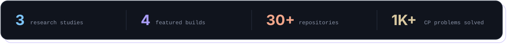

  <a href="https://github.com/shuyeb00/bangla-calibration">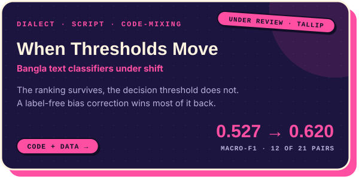</a>
  <a href="https://github.com/shuyeb00/knn-distance-metrics-comparative-study">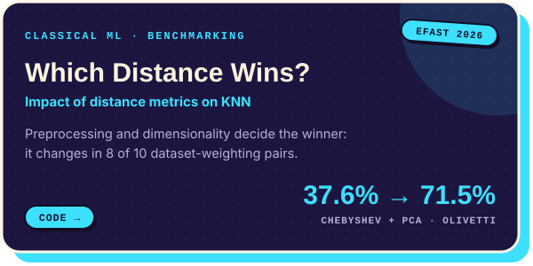</a>
  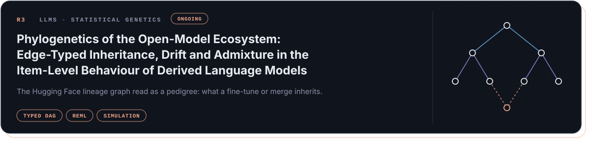

Model outputs for the threshold-shift study are archived on Zenodo: <a href="https://doi.org/10.5281/zenodo.24057514">doi:10.5281/zenodo.24057514</a>

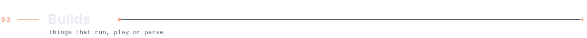

  <a href="https://github.com/shuyeb00/AirSlice">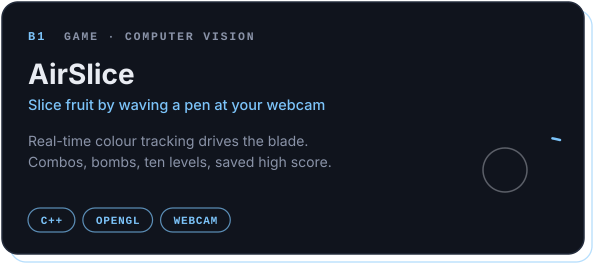</a>
  <a href="https://github.com/shuyeb00/rabona-lang">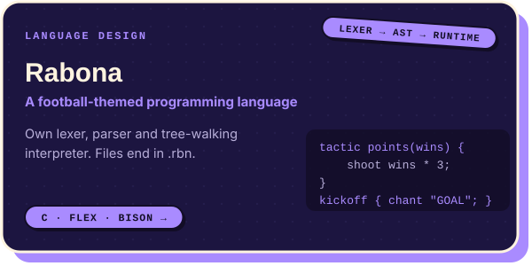</a>
  <a href="https://github.com/shuyeb00/smartcare">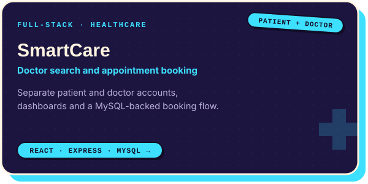</a>
  <a href="https://keen-keeper-eight-flax.vercel.app/">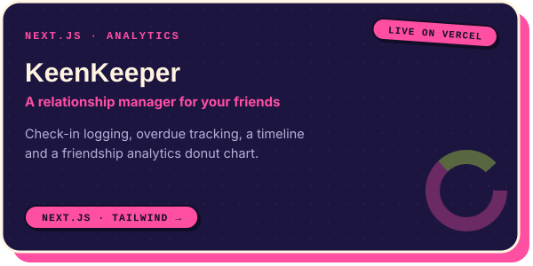</a>

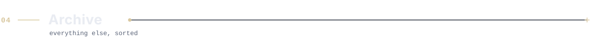

| Project | What it is | Stack |
|---|---|---|
| [Digitools](https://github.com/shuyeb00/digitools-platform) | Digital-products store with cart, checkout and toasts | React · Tailwind · DaisyUI |
| [React World Tour](https://github.com/shuyeb00/React_World_Tour) | Country explorer built while learning React | React · Vite |
| [GitHub Issue Tracker](https://github.com/shuyeb00/Github-Issue-Tracker) | Issue board with open and closed tabs | JavaScript · Tailwind |
| [Job Application Tracker](https://github.com/shuyeb00/Job-Application-Tracker) | Track applications through the pipeline, pure DOM | JavaScript |
| [English Janala](https://github.com/shuyeb00/English_Janala) | Lesson-by-lesson English vocabulary app | JavaScript · Tailwind |
| [Knowledge Vault](https://github.com/shuyeb00/knowledge-vault) | "Second brain" notes app landing page | HTML · CSS |
| [Techwave](https://github.com/shuyeb00/Techwave) · [Tea House](https://github.com/shuyeb00/Tea-House-) · [G3 Architecture](https://github.com/shuyeb00/Landing-Page-G3-Architecture) | Hand-built landing pages | HTML · CSS |
| [Portfolio](https://github.com/shuyeb00/my-portfolio) | Personal portfolio | React · Vite · Tailwind |
| [MetroMan](https://github.com/shuyeb00/MetroManGame) | Hangman-style word game with a custom GUI | Java · Swing |
| [School](https://github.com/shuyeb00/School-Management-System) · [Restaurant](https://github.com/shuyeb00/Restaurant-management-system) management | OOP design exercises with classes for every role | Python |
| [Doubly Linked List](https://github.com/shuyeb00/Doubly_LinkedList) | Data-structure implementation from scratch | C++ |
| [XPSC Tasks](https://github.com/shuyeb00/XPSC_tasks) · [CP Marathon MU](https://github.com/shuyeb00/CP_Marathon_MU) | Weekly problem sets and contest solutions | C++ |

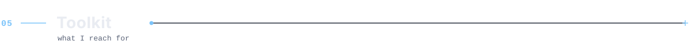

  <picture>
    <source media="(prefers-color-scheme: dark)" srcset="https://skillicons.dev/icons?i=py,pytorch,sklearn,c,cpp,java,js,react,nextjs,nodejs,express,mysql,tailwind,git,linux&theme=dark&perline=15">
    
  </picture>

Also Hugging Face Transformers, LoRA fine-tuning, conformal prediction, and LaTeX for everything that has to look right.

  

